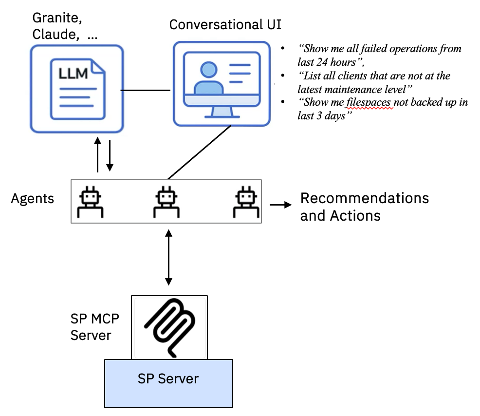
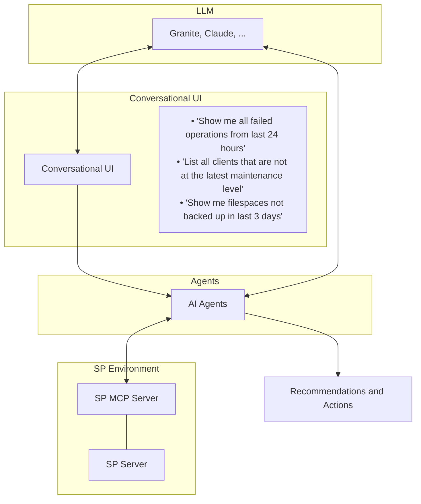

# IBM Storage Protect - MCP Server Requirements & Acceptance Criteria

**Date Opened:** 22 Jan 2026 &emsp;&emsp;&emsp;&emsp; **Approval Date:**

---

**Description** - IBM Storage Protect MCP Server introduces an AI-powered operational experience designed to simplify, modernize, and automate the administration of IBM Storage Protect (SP) environments.

---

## Document Overview & Reference Links

| Field | Details |
| :--- | :--- |
| **PM Owner** | Girish Dadge |
| **Submitter / Origin** | *(Not specified)* |
| **Lead Architect** | Albee Jhoney |
| **Key Links & Artifacts** | • **Monday board link:** [https://ibm.monday.com/boards/7880880628/pulses/10942967848](https://ibm.monday.com/boards/7880880628/pulses/10942967848) • **GitHub repo link:** [https://github.com/IBM/ibm-storage-protect-mcp-server](https://github.com/IBM/ibm-storage-protect-mcp-server) • **PRD link:** [https://ibm.ent.box.com/file/2151489275388?s=3si03k60rvtcf9lm6hg8a869svzu26ca](https://ibm.ent.box.com/file/2151489275388?s=3si03k60rvtcf9lm6hg8a869svzu26ca) • [SP_MCP_Server_setup video](https://ibm.box.com/s/a45ogno0l7ljtj391uwvqhu16rq9huu3) • [SP_MCP_install_guide.docx](https://ibm.box.com/s/fbyv8cg4xvbfo945diceuwsaj9vw9lkm) |
| **Theme** | |
| **Initiative** | |

*[Submitter to fill out; \* indicates a required field]*

---

## Problem & User Description

### \* Customer Problem

Organizations face growing challenges in managing SP environments due to workforce skill gaps, complexity, and lack of automation.

The Storage Protect AI MCP Server acts as a standardized bridge between Large Language Models (LLMs)—such as Anthropic’s Claude, OpenAI’s ChatGPT, or Granite. By implementing the open-source Model Context Protocol (MCP), the MCP server exposes SP’s robust data as a discoverable "Tool" with "Resources" that users can query and AI agents can utilize.

### Target User & User Outcome

> **Format:** As a `<user role/persona>`, I want `<goal/objective of user>` so that I can `<benefit/result/some reason>`

**Expected outcomes for the Storage Protect AI MCP Server include:**
- Simplify and modernize management of SP
- Improve admin productivity
- Provide enhanced data insights
- Reduce SP skill requirements and make it easier to onboard new hires

**Persona & User Story:**
> *As a newly hired backup administrator, I want a conversational interface that helps me quickly learn and manage Storage Protect Day 2 operations so I can become more productive and expand my ability to support additional domains.*

**Illustrative Examples:**
- I want a conversational interface to quickly check backup status rather than learning complex command line interfaces or complex GUI navigations.
- I want to ask *"Why did the SQL backup fail last night?"* so that I can get an immediate root-cause summary and log analysis without manually digging through multiple logs.
- I want to ask *"List all clients that are not at the latest maintenance level"* so that I can easily identify what systems need to be upgraded.
- I want to ask *"Show me filespaces not backed up in the last 3 days"* so that I can easily replace a TSMManager report that I currently rely on.

### User Assumptions & Historical Context

*What assumptions do we have about our end user? What are the riskiest assumptions? What must be true for this idea to work?*

- **Assumptions:** SP admins are retiring and it is tough to find skilled replacements and/or train new hires.
- **Competitive considerations:** Many competitors have announced or have plans for MCP servers (e.g., Veeam, Commvault, Cohesity).
- **RFP considerations:** Going forward, expect MCP server to become a standard RFP check box item.
- **Risks:** Existing scripts and customer process will slow transition to a conversational interface.
- **For this idea to work:** Customer desire/direction is to modernize their SP environment and break down existing siloed IT operations by utilizing AI to assist with employees becoming more non-specialized / IT generalists.

---

## Scope

*[PM/Dev/Solution Architecture to fill out]*

### Delivery Channel

- **Open-source SP MCP server:** Objective to rapidly iterate and modify based on customer feedback. At a later point we can make decision to ship as supported part of SP based on market input.
- **Best-effort support:** Same support expectations as are defined for SP ansible open-source offering.

#### Documented rationale for approval to open source the MCP server for Storage Protect:
- **What is the proposed model for ongoing ownership, governance, and management of the code base and deliverables?**
  - *The same model and considerations as SP ansible open-source offering.*
- **Has there been any assessment of potential revenue impact, if any, from open‑sourcing this asset?**
  - *No near-term SP revenue impact from open source.*

### Deployment Considerations

- **Alongside CLI (`dsmadmc`, `dsmc`, `servermon`):** For single-SP server operations. This includes an option for the SP MCP server to be installed on the SP Server machine (potential performance considerations).
- **Alongside Operation Center:** For multi-SP server operations / data aggregation across SP server estate.
- **Transports:** Supports both MCP transports: `stdio` (for local, desktop clients) and `StreamableHTTP` (for web or remote clients). MCP client can be on the same machine as MCP server and/or remote from MCP server.
- **Cross-platform:** The MCP server is distributed as a Python project and is effectively cross-platform.
- **Topology:** For MVP, one MCP server must support one SP server. As part of rollout (not required for MVP), consider a given SP server could have multiple MCP servers connected to it or 1 MCP server could be associated with multiple SP servers.

### Security Considerations

- Treat the SP MCP server as part of a customer management plane that has access to the SP server DB and potentially SP server configuration controls. Need to lock down identity and tool behavior very tightly in alignment with SP identity and access controls.
- For MVP, the MCP server will be associated with a single SP admin credential. We will discuss/get customer feedback and refine security considerations.
- By default, the MCP server will support SP read-only operations. There can be an option to allow configuration operations. But, the user must be very careful with this and needs to be reminded this should be used with extreme care and not in production. We will gather feedback and refine the security model with appropriate guardrails for production.

### Usage Considerations

- **Tool Logging:** Log MCP server tool usage. This could be part of the customer feedback loop with customer providing a log of MCP server tool usage, ability to count how frequently being used and success/failure of operations.
- **Cross-product MCP interactions:** Future consideration related to interaction and usage with other product’s MCP servers.

### Operation Scope

- **For SP Server objects:** SP Server, SP Options, Storage pool (primary & copy), Storage pool volumes, Dependency graph, Device class, Libraries / drives, Activity log
- **For SP Client objects:** Nodes, Filespaces, Options, Schedules, Associations, Backup objects
- **For Policy objects:** Policy domain, Policy set, Management class, Copy groups, Schedules
- **For Job objects:** Backup/restore jobs, administrative / scheduled jobs, Summary table
- **For Security, health & capacity:** Admin roles & privileges, Authn config, Audit, Reclamation effectiveness, Capacity metrics, Dedup / compression metrics
- **Future integrations:** Future consideration to leverage tape, FlashSystem, Scale MCP servers for integrated use cases with SP backend.

### GTM & Collaterals

- **Target Market:** Existing SP customers, skill-limited enterprises.
- **Positioning:** AI-powered operational simplicity.
- **Collateral:** Solution brief for MCP deployment -- LLM usage/additional AI considerations, …
- **Best Practices:** Publish prompt recommendations -- crowdsourced & validated for usecases / data requirements.

### Architecture Diagram

### Links to any related PRDs

*Not PRDs, but provided links to Storage Insights and Scale MCP servers:*

- **IBM Storage Insights MCP Server** (observability for FlashSystem, DS8K, etc.)  
  GitHub repo: [https://github.com/IBM/ibm-storageinsights-mcpserver](https://github.com/IBM/ibm-storageinsights-mcpserver)
- **IBM Storage Scale MCP Server** (Spectrum Scale / GPFS)  
  GitHub repo: [https://github.com/IBM/ibm-storage-scale-mcp-server](https://github.com/IBM/ibm-storage-scale-mcp-server)

---

## \* Known/Anticipated Limitations / Out of Scope

> *For example, the performance scalability goals are significant and maybe there is a rev 1 that gets part way there..*
>
> *What is not being delivered that should?*

---

## \* Acceptance: [PM/Development]

> \**Reviewed in 3iab. Need Acceptance before moving out of Solution Review phase*\*  
> \*\**Once accepted a link will be provided on the OT for Sales and Marketing to review*\*\*
>
> **Include:**
> - Requirement Implementation Proposal Summary
> - Phases
> - List of reviewers
>
> **Are all parties Aligned? What is the plan for this requirement?**  
> *On hold, needs further research/discussion, go forward with development.*
>
> **Is the MVP for this Requirement clear?**  
> **Currency Acceptance criteria:**
> - Upgrade from older version
> - Full functionality support
> - Restore from older version post upgrade to newer version
> - Public documentation update
> - Internal performance reference
> - QA Automation testing -
>
> **Platform:** Linux is MVP  
> **Scope:** 8.2 MVP followed by 8.1.x  
> **Description of tool…** Is LLM picking right tool and is it passing right parms on `dsmadmc`.. token usage (re. measure of goodness)  
> **Examples of prompts where tools behave properly**  
> **LLM usage/validation with prompts:** Claude is MVP (public), private Llama vs. Granite – check with Erin

---

## Implementation Details

> Targeted Stream, Squad(s) assigned, etc….

---

## Links to Playback / Artifacts / Design Meeting Recordings

> *Artifacts should primarily be in IBM Storage Defender Documentation Repo...exceptions should be approved on a one-off basis...*
>
> - *Playback 0 -*
> - *Playback 1 -*
> - *Release Playback -*

---

## Change Control (PCR)

> IF requirement or proposal changes the updates need to be reviewed by the Dev/PM/UX Interlock for change approval.

