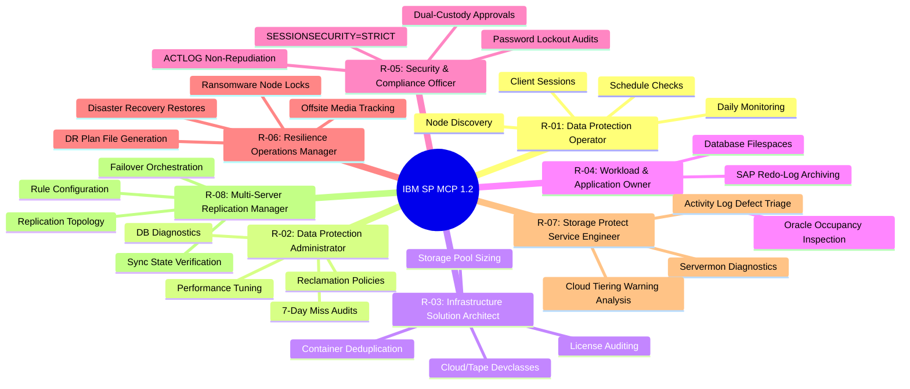
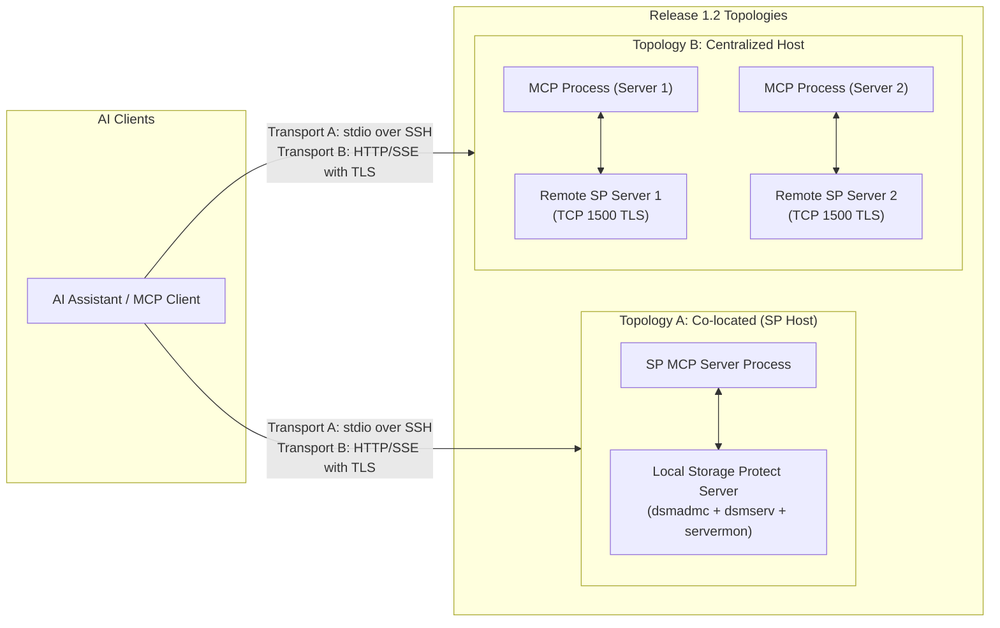
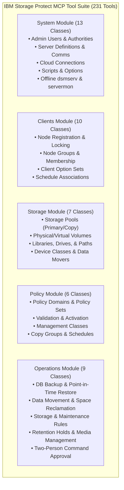

# IBM Storage Protect - MCP Server Requirements & Acceptance Criteria — Release 1.2

**Date Opened:** 22 Jan 2026 &emsp;&emsp;&emsp;&emsp; **Release 1.2 Target:** October 2026 &emsp;&emsp;&emsp;&emsp; **Status:** ✅ Approved / Baseline Implemented

---

## Executive Summary & Document Evolution

The **IBM Storage Protect (SP) MCP Server Release 1.2** represents the production enterprise hardening and modular architecture evolution of the original Release 1.0 (MVP) specification. While Release 1.0 established the initial feasibility of an AI-driven Model Context Protocol bridge for single-server SP administration, Release 1.2 reverse-engineers enterprise requirements across security, role-based access control, distributed multi-server topologies, least-privilege scoping, dynamic delegated authentication, OAuth 2.1 resource server integration, and automated resilience testing.

This document serves as the authoritative, updated **Product Requirements Document (PRD-1.2)**, synthesizing all architecture, design, analysis, implementation, and operational guide artifacts into a consolidated requirement baseline.

---

## Document Overview & Reference Links

| Field | Details |
| :--- | :--- |
| **Product Name** | IBM Storage Protect MCP Server (Release 1.2) |
| **PM Owner** | Girish Dadge |
| **Lead Architect** | Albee Jhoney |
| **Initiative** | AI-Powered Data Protection Management & Open Governance |
| **Primary Repositories** | • **GitHub Repo:** [https://github.com/IBM/ibm-storage-protect-mcp-server](https://github.com/IBM/ibm-storage-protect-mcp-server)<br>• **Monday Board:** [Pulse 10942967848](https://ibm.monday.com/boards/7880880628/pulses/10942967848)<br>• **PRD Box:** [SP MCP Box File](https://ibm.ent.box.com/file/2151489275388?s=3si03k60rvtcf9lm6hg8a869svzu26ca) |
| **Key Architecture Docs** | • [`architecture.md`](../../architecture/architecture.md) & Module Specs (`module-*.md`)<br>• [`security-design-analysis.md`](../../analysis/security-design-analysis.md)<br>• [`security-dynamic-authn.md`](../../design/security-dynamic-authn.md) · [`security-oauth2.md`](../../design/security-oauth2.md) |
| **Implementation & Guides** | • Implementation Specs: [`docs/implement/impl-security-*.md`](../../implement/)<br>• Deployment Guides: [`planning-guide.md`](../../guides/planning-guide.md) · [`install-guide.md`](../../guides/install-guide.md) · [`configure-guide.md`](../../guides/configure-guide.md)<br>• Security Guide: [`local-idp-oauth2-guide.md`](../../guides/local-idp-oauth2-guide.md) · [`troubleshoot.md`](../../guides/troubleshoot.md) |
| **Verification & Quality** | • [`traceability-matrix.md`](../../traceability/traceability-matrix.md) · [`gap-analysis.md`](../../traceability/gap-analysis.md) · [`audit-report.md`](../../traceability/audit-report.md)<br>• [`test-specifications.md`](../../test/test-specifications.md) · [`test-cases.md`](../../test/test-cases.md) · Allure Results (`allure-results/`) |

---

## 1. Problem & User Description (Updated for 1.2)

### 1.1 Customer Problem Statement
Enterprises managing IBM Storage Protect estates face accelerating operational challenges:
1. **Workforce Skill Gaps & Knowledge Depletion**: Experienced SP/TSM storage administrators are retiring, while onboarding junior backup operators or IT generalists is hampered by complex CLI syntax (`dsmadmc`), nested policy hierarchies, and disparate diagnostic tools (`dsmserv`, `servermon`).
2. **Security & Regulatory Compliance Exposure**: Deploying generative AI assistants in administrative planes introduces severe risks: credential exfiltration from prompt injection, untracked write operations, inadvertent execution of destructive commands, lack of dual custody, and compliance violations (NIS2, DORA, SOC 2, HIPAA).
3. **LLM Context Window Saturation**: Exposing a monolithic catalogue of 230+ administrative tools to an LLM agent consumes excessive context tokens, degrades model reasoning accuracy, and increases latency and cost.
4. **Siloed Multi-Server Operations**: Enterprise backup architectures encompass multiple SP instances across geographic sites, tape libraries, cloud object pools, and replication partners without a unified, conversational orchestration plane.

### 1.2 Target Personas & Operational Outcomes
Release 1.2 formalizes **eight distinct operational personas**, each mapped to dedicated tool sets, prompt patterns, and security guardrails:



---

## 2. Updated Architectural & Deployment Requirements

### 2.1 Dual Operating Model (Unified vs. Micro-MCP)
* **REQ-ARCH-01 (Unified MCP Server)**: The server MUST provide a unified entry point (`src/sp_mcp_server/main.py`) capable of running all functional tool modules in a single process over `stdio` or `streamable-http`.
* **REQ-ARCH-02 (Micro-MCP Modular Scoping)**: The server MUST provide 25+ specialized Micro-MCP entry points (`main_<module>_*.py`), enabling process-level isolation and fine-grained tool registration to optimize LLM context window token efficiency:
  - Clients: `main_clients_core.py`, `main_clients_config.py`
  - Storage: `main_storage_pools.py`, `main_storage_hardware.py`, `main_storage_device.py`, `main_volumes.py`
  - Policies: `main_policies_lifecycle.py`, `main_policies_management.py`
  - System: `main_system_admin.py`, `main_system_config.py`
  - Operations: `main_ops_protection.py`, `main_ops_maintenance.py`, `main_ops_rules.py`

### 2.2 Deployment Topologies & Transports
Release 1.2 standardizes on two deployment topologies across two transport protocols:

| Deployment Attribute | Topology A: Co-located | Topology B: Centralized Control Host |
| :--- | :--- | :--- |
| **Host Placement** | Runs directly on the IBM SP server host | Runs on an independent dedicated management server |
| **SP Server Coupling** | 1 process manages local SP server via local socket / IPC | 1 process per SP server; connects remotely over TCP 1500 (TLS) |
| **Offline Tool Access** | Full access to `dsmserv` and `servermon` via `sudo` | Online commands (`dsmadmc`) only; offline tools disabled |
| **Transport A: `stdio`** | Client SSH-es directly to SP host (`mcp-runner` user) | Client SSH-es to central host; server talks TCP to SP |
| **Transport B: `http`** | Uvicorn SSE on SP host with local TLS certs | Uvicorn SSE on central host with enterprise TLS & OAuth 2.1 |



---

## 3. Comprehensive Requirements Catalog (51 Security Controls & Features)

### 3.1 Network Security (NET)
* **NET-1 (Strict Session Security Startup Validation)**: The server MUST issue `QUERY ADMIN <name> FORMAT=DETAILED` at startup for all configured credentials and verify `Session Security: Strict`. If any account is not `Strict`, the server MUST abort immediately (`sys.exit(1)`).
* **NET-1c (Production Startup Guard)**: When `SP_MCP_ENV=production`, the bypass environment variable `SP_MCP_SKIP_SECURITY_CHECKS=1` MUST be strictly prohibited and abort server initialization.
* **NET-2 (SSH Ed25519 Key Authentication)**: Remote `stdio` invocation MUST mandate SSH public key authentication using Ed25519 keys with `StrictHostKeyChecking=yes`. Plaintext password tools (`sshpass`) are prohibited.
* **NET-3 (Enforced Client-Side TLS & Stanza Binding)**: Client configuration templates (`config/dsm.sys.template`) MUST mandate `SSLREQUIRED Yes` and `SSL Yes`. Furthermore, all CLI wrapper invocations (`execute` and `execute_silent`) MUST consistently append `-SE=<SP_SERVER_NAME>` to guarantee deterministic server targeting.

### 3.2 Identity & Credentials Management (CRED)
* **CRED-1 (Five-Tier Service Account Isolation)**: The server MUST support five discrete administrative credentials representing least-privilege tiers:
  1. `system`: Full administrative authority (server, script, connection definition).
  2. `policy`: Policy domain, client node, and copy group administration.
  3. `storage`: Storage pools, volumes, devices, drives, and data movers.
  4. `operator`: Daily job monitoring, DB backup, and diagnostic runs.
  5. `readonly`: Query-only discovery operations.
* **CRED-2 (Password Stash / Process Argument Masking)**: When `SP_MCP_USE_PASSWORD_STASH=1` is set (`PASSWORDACCESS GENERATE`), the CLI wrapper MUST omit the `-PA=` argument entirely, eliminating password exposure in system process tables (`/proc/<pid>/cmdline`).
* **CRED-3 / CRED-3a,b (POSIX 0600 Permissions & Secure Startup)**: `secure_startup()` MUST execute across all 26 server entry points, rejecting `.env` or credential files readable by group or world (`0600` strictly enforced).
* **CRED-4 / CRED-5 (Provisioning Automation)**: The system MUST supply an idempotent shell provisioning script (`scripts/provision-sp-service-accounts.sh`) to automatically configure the 5 tiered service accounts on IBM SP with `SESSIONSECURITY=STRICT` and `MFAREQUIRED=NO`.
* **CRED-6 (Keyring-First Secret Resolution)**: Secret values (`SP_ADMIN_PASSWORD`, connection access keys) MUST check the local OS keyring before falling back to plain environment variables.

### 3.3 Access Management & Tool Scoping (ACC)
* **ACC-1 (Explicit Tool Privilege Declaration)**: Every concrete tool class MUST inherit from `BaseCommand`, `BaseOfflineCommand`, or `BaseServermonCommand` and declare an explicit `required_privilege` property (`system`, `policy`, `storage`, `operator`, or `any`).
* **ACC-2 (Self-Narrowing Dynamic Tool Registration)**: During initialization in service-account mode, the server MUST inspect the active administrator's granted SP authorities and self-narrow the registered MCP toolset (`_PRIVILEGE_SATISFIES`), never exposing unauthorized tools to the client.
* **ACC-4 / ACC-4a (Sudoers Least-Privilege Execution)**: Offline commands (`dsmserv`) and diagnostic monitors (`servermon`) MUST execute as the SP instance user via `sudo -u <instance_user> -- <binary>` restricted by a locked-down `/etc/sudoers.d/sp-mcp-server` configuration.

### 3.4 Policy Management & Two-Person Integrity (POL)
* **POL-1 (Dual-Custody Command Approval Lifecycle)**: High-impact or destructive operations MUST support IBM SP native Command Approval (`ApprovePendingCmd`, `RejectPendingCmd`, `WithdrawPendingCmd`).
* **POL-2 (Password Pre-Validation)**: Tools that create or modify passwords (`DefineAdmin`, `RegisterNode`, `UpdateUser`, `UpdateNode`) MUST pre-validate the proposed password length against the live Storage Protect server's `MINPWLENGTH` setting before dispatching the CLI command.
* **POL-3 (Lockout Policy Startup Audit)**: The server MUST audit `INVALIDPWLIMIT` at startup and generate operational warnings if account lockout protection is disabled (`INVALIDPWLIMIT=0`).
* **POL-4 / POL-4a (ACTLOG Audit Attribution & Fail-Closed Alerts)**: Before executing any write or modifying tool, the server MUST emit a correlation record into the SP Activity Log:
  ```text
  DEFINE SCRATCHPADENTRY MCP_AUDIT DESCRIPTION="MCP_AUDIT user=<id> tool=<name> priv=<priv> corr=<uuid> authmodel=<authmodel>"
  ```
  Failures to record audit entries MUST be logged with `SECURITY [POL-4 / RG-4]` markers and abort execution when strict mode is active.

### 3.5 Secure Integrations & Secrets Indirection (INT)
* **INT-1 (Directory Integration)**: Support LDAP/Active Directory authenticated service accounts (`UPDATE ADMIN AUTHENTICATION=LDAP`).
* **INT-2 / INT-2a,b (OAuth 2.1 HTTP SSE Transport Security)**: When running HTTP transport (`--transport http`), the server MUST mandate application TLS (`SP_TLS_CERT`, `SP_TLS_KEY`) and require OAuth 2.1 / OIDC Bearer Tokens with scope-to-privilege mapping (`mcp:system` -> `system`, `mcp:readonly` -> `readonly`).
* **INT-3 / INT-3a (Secrets Indirection & Silent Execution)**: Sensitive connection parameters MUST support indirection (`keyring:name`, `env:NAME`). Password-bearing commands MUST use `execute_silent()`, suppressing plaintext logging across all handlers.

### 3.6 Non-Repudiation & Forensic Auditability (NR)
* **NR-1 (End-User Identity Binding)**: The authenticated caller identity (`current_audit_user` ContextVar) MUST be captured from OIDC `sub` or dynamic session and stamped into every ACTLOG audit entry.
* **NR-2 (Host Log Anti-Tampering)**: The server deployment guides MUST mandate append-only host log attributes (`chattr +a`), restricted directories (`0700`), and 90-day retention.
* **NR-3 (Forensic Query Tool)**: Provide `query_activity_log` with search filters for date, severity, and message numbers.
* **NR-4 (Strict Audit Fail-Closed Mode)**: When `SP_MCP_STRICT_AUDIT=1`, administrative write operations MUST immediately abort if the ACTLOG scratchpad write fails.
* **NR-5 (Standardized ISO 8601 UTC Logging)**: All logging handlers MUST format timestamps strictly in ISO 8601 UTC format (`%Y-%m-%dT%H:%M:%SZ`).

### 3.7 Dynamic & Delegated Authentication (DAUTH)
* **DAUTH-1 (Dynamic Authentication Challenge-Response)**: When `SP_MCP_AUTH_MODE=dynamic`, unauthenticated tool invocations MUST return a structured `AUTHENTICATION_REQUIRED` response containing target server details and lease parameters.
* **DAUTH-2 / DAUTH-2a (Ephemeral Lease Mints via Silent Auth)**: A dedicated `authenticate_session` tool MUST verify SP administrative credentials via zero-trace `execute_silent()` and mint an in-memory `SessionLease`.
* **DAUTH-3 / DAUTH-6 (Bounded Sliding TTL & Concurrency Synchronization)**: Ephemeral leases MUST enforce an inactivity sliding TTL (default 15m) capped by `MAX_SESSION_TTL_SECONDS`. The `SessionManager` MUST be thread-safe via `RLock`.
* **DAUTH-4 (Per-Call Session Privilege Enforcement)**: Session authority MUST be validated against tool requirements prior to invocation, rejecting violations with `AUTHORIZATION_DENIED`.
* **DAUTH-5 / DAUTH-5a,b (Delegated Subprocess Credentials & Clean Teardown)**: Verified session credentials MUST be injected into execution via `current_execution_credentials` ContextVar and guaranteed reset to `None` in `finally` blocks.
* **DAUTH-7 (Target-Server Stanza Binding)**: `SessionLease.target_server` MUST be validated against the active MCP server target, preventing cross-server token replay.
* **DAUTH-8 / DAUTH-9 (Deterministic Credential Zeroing & Explicit Revocation)**: Plaintext passwords in `SessionLease` MUST be overwritten with `None` on all eviction paths (expiry, sweep, server shutdown), complemented by an explicit `logout_session` tool.

### 3.8 OAuth 2.1 Extended Resource Server Middleware (OA)
* **OA-1 (Authorization Server Metadata Proxy)**: Serve RFC 8414 metadata at `/.well-known/oauth-authorization-server`.
* **OA-2 (Rate-Limited JWKS Rotation Cache)**: Cache public JWKS keys with TTL and rate-limit re-fetch on unknown `kid` to at most once per 60 seconds.
* **OA-3 / OA-4 (Authorization Code + PKCE Enforcement)**: Accept PKCE token claims and audit upstream IdP PKCE capabilities at startup (`S256` required).
* **OA-5 (RFC 7662 Token Introspection)**: Support optional real-time token introspection when `SP_OIDC_INTROSPECTION_ENDPOINT` is configured.
* **OA-6 (RFC 9470 Protected Resource Metadata)**: Serve resource metadata at `/.well-known/oauth-protected-resource` and advertise metadata URIs in `WWW-Authenticate` headers.
* **OA-7 (`authmodel` Audit Attribution)**: Categorize caller authentication method (`client_credentials`, `oidc_bearer`, `dynamic_session`, `local`) and stamp it into the ACTLOG scratchpad record.

---

## 4. Functional Command Tool Suite (231 Tools)

Release 1.2 delivers **231 fully implemented MCP tools** partitioned across five core architectural modules:



---

## 5. Controlled Resilience, Negative & Stress Requirements

Release 1.2 introduces stringent resilience and automated testing standards:

### 5.1 Negative Testing & Security Abuse (NEG-01..25)
* Protocol invalidation, schema violations, type mismatches, and oversized payload rejection.
* Privilege boundary enforcement and cross-server session replay mitigation.
* Cryptographic signature forgery rejection, expired token rejection, untrusted issuer blocking.
* Shell injection defense via explicit argument vectors (`subprocess.run(args, shell=False)`).

### 5.2 Controlled Environmental Failures (ENV-01..15)
* Subprocess exit traps handling IBM SP return codes (`ANS1017E`, `ANS1025E`, `ANS1353E`).
* Upstream IdP 503 outages and network latency handling via chaos proxies.
* Disk exhaustion (`ENOSPC`) and ACTLOG disk full handling under strict audit (`SP_MCP_STRICT_AUDIT=1`).

### 5.3 Stress & Capacity Benchmarks (STR-01..10)
* Sustained load: 200 concurrent auth handshakes.
* High session churn: 1,000 ephemeral leases created, exercised, and expired without memory leaks.
* Locust load profiles validating multi-user SSE concurrency.

---

## 6. Acceptance & Quality Assurance Criteria

To achieve release sign-off, Release 1.2 satisfies the following acceptance criteria:

1. **Automated Test Baseline**:
   - **266 collected automated tests across 15 test files**.
   - **100% Pass Rate** in default test execution (248 passed, 18 skipped: 15 live integration stubs + 3 Windows POSIX permission bit tests).
   - Zero test failures and clean test isolation (no state leakage across ContextVars).
2. **Security Controls Closure**:
   - **51 of 51 defined security requirements** verified and closed (100% compliance across NET, CRED, ACC, POL, INT, NR, DAUTH, and OA domains).
3. **Prompt & Persona Validation**:
   - All 8 operational personas validated across 103 positive tests (`test_sample_prompts_positive.py`) and 18 adversarial negative tests (`test_sample_prompts_negative.py`).
4. **Documentation Completeness**:
   - Complete guides for Planning, Installation, Configuration, Local IdP OAuth2 Setup, Troubleshooting, and User Operations.
   - Comprehensive Requirements Traceability Matrix and Gap Analysis showing 0 open security or documentation gaps.

---

## 7. Change Control & Governance

Any modifications to this PRD or architectural requirements must be reviewed and approved via the **Dev/PM/Security Architecture Interlock**. Changes affecting tool schemas, privilege tiers, or authentication flows require a formal Product Change Request (PCR) and automated regression test verification.

